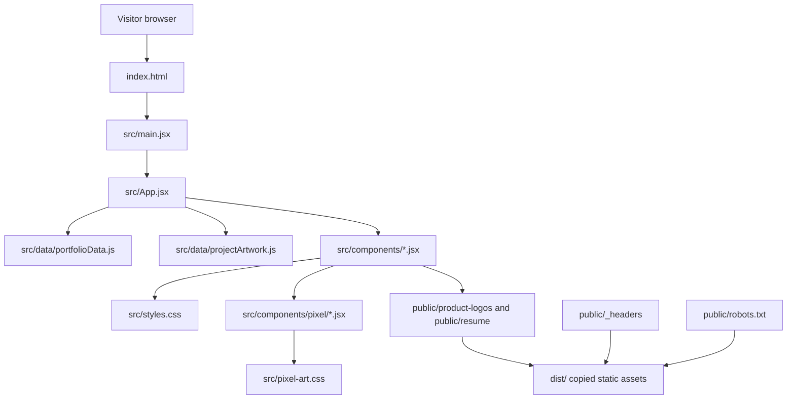

# Architecture

## High-Level Architecture

This repository is a Vite-powered React single-page static site. Vite builds the app into static files under `dist/`. The deployed site can be hosted on static hosting providers such as Cloudflare Pages.

There is no backend process, API server, database, authentication system, server-side rendering, service worker, or runtime storage layer in the current repository.

## Entry Points

| File | Role |
| --- | --- |
| `index.html` | HTML shell, page metadata, noindex meta tags, and script entry. |
| `src/main.jsx` | React root mounting point. |
| `src/App.jsx` | Main page composition and section order. |
| `src/data/portfolioData.js` | Source of truth for navigation labels, product data, resume links, GitHub cards, and contact items. |
| `src/data/projectArtwork.js` | Stable decorative mapping from project IDs to dinosaur, environment, chest, and reward variants. |
| `src/styles.css` | Global styling, layout, responsive behavior, and component classes. |
| `src/pixel-art.css` | Original geometric mosaic artwork tokens, geometry, CSS motion, responsive recomposition, and reduced-motion rules. |
| `tests/portfolio-integrity.test.mjs` | Eleven dependency-free Node integrity tests for content, artwork, accessibility-source, privacy, and noindex contracts. |

## Major Modules

| Module | Purpose |
| --- | --- |
| `Navbar.jsx` | Sticky top navigation and profile icon links. |
| `Hero.jsx` | First-screen positioning, CTA buttons, and product-builder signal cards. |
| `SectionHeader.jsx` | Shared section heading component. |
| `ProductCard.jsx` | Compact product cards with a mapped decorative treasure scene, tech chips, source note, live-product link when available, and case-study anchor. |
| `pixel/PixelSpriteLibrary.jsx` | Reusable organic dinosaur and angular chest/reward SVG symbols. |
| `pixel/PrehistoricLandscape.jsx` | Hero landscape, developer T-Rex, chest, ferns, flowers, environmental layers, and the signature meteor. |
| `pixel/AboutPrehistoricScene.jsx` | Calm decorative Brachiosaurus landscape paired with the About copy. |
| `pixel/ProjectTreasureScene.jsx` | Project-specific decorative composition selected from the stable artwork mapping. |
| `pixel/MosaicEnvironmentPrimitives.jsx` | Shared authored cloud, tree, fern, rock, flower, and ground geometry. |
| `src/assets/mosaic-network.svg` | Original irregular cell network used at low contrast as a decorative mask. |
| `ProductDetail.jsx` | Detailed case study sections with highlights, tech stack, and source-code note. |
| `ResumeCard.jsx` | Resume download cards using normal anchor downloads. |
| `ContactCard.jsx` | Contact/profile/location cards. |
| `Footer.jsx` | Footer and back-to-top link. |

## Data Flow

1. `src/data/portfolioData.js` exports arrays and objects.
2. `src/App.jsx` imports that data and maps it into reusable components.
3. Components receive data as props.
4. Components render static markup and links.
5. `src/data/projectArtwork.js` selects decorative scene variants by stable product ID without duplicating product facts.
6. CSS in `src/styles.css` controls semantic page layout and reading surfaces; `src/pixel-art.css` controls mosaic art grammar, motion, art breakpoints, and reduced-motion states.

The app does not fetch remote data at runtime.

The test suite imports the static data modules and inspects selected source/configuration files. Its accessibility checks are static contracts for navigation, touch, contrast, and motion hooks; it does not enter the browser runtime or provide rendered visual-regression, axe, screen-reader, or device-emulation coverage.

## State Flow

The only React state is local to `Navbar.jsx`: it tracks whether the mobile menu is open and whether the mobile media query currently matches. Escape closes the menu and restores focus to its toggle; choosing a navigation link closes it. There is no global state manager, context provider, product state, or local persistence. Portfolio content and artwork rendering remain deterministic from static data imports.

## Persistence and Storage

No browser storage, database storage, cookies, localStorage, sessionStorage, or server persistence is used by this website.

Static files in `public/` are copied into `dist/` during `npm run build`.

## External Integrations

| Integration | How it appears |
| --- | --- |
| GitHub profile | External links to `https://github.com/ShauryaDas924`. |
| LinkedIn profile | External links to `https://www.linkedin.com/in/shauryadas/`. |
| Email | `mailto:` link in contact data. |
| Public product destinations | Outbound links to live products, including Whoopberry and Chrome Web Store listings; no data is fetched from them. |
| Cloudflare Pages headers | `public/_headers` for `X-Robots-Tag` noindex headers. |

No analytics or tracking integrations are present in the repo.

## Security Model

This site is static and public to anyone with the link. The security model is primarily about not publishing sensitive material.

Important boundaries:

- Do not add private source code.
- Do not add secrets, API keys, tokens, environment files, certificates, logs, database dumps, or private local paths.
- Do not add public source-code links for private products.
- Do not add analytics or tracking without explicit approval.
- Treat resume PDFs as public once placed in `public/resume/`.

## Permission Model

The portfolio website itself requests no browser permissions.

Some product case studies describe browser extensions, native macOS helpers, privileged helpers, LaunchAgents, LaunchDaemons, iOS Keychain, authentication, or AI systems. Those are descriptions of other projects and are not implemented in this repository.

## Error Handling Patterns

The art registry returns a generic presentation-only scene for an unknown project ID, while authoritative product text and links remain unchanged. `PixelSprite` rejects unknown sprite names by rendering nothing instead of creating an arbitrary fragment reference.

Other links and content are static. There is no runtime error boundary or network error handling in the current repo.

## Decorative Artwork and Motion

The organic geometric mosaic artwork is static React markup with authored irregular SVG symbols and scenery, styled and animated by CSS. Repeated figures are declared once and rendered through safe SVG `<use>` references with smooth vector rendering. The system introduces no game loop, canvas runtime, animation package, interval, scheduler, or recurring React state update. The long-running meteor and small environmental effects are CSS animations using transforms and opacity. Treasure-chest reactions are CSS states driven by hover-capable pointer interaction and the card's existing `:focus-within` state; touch layouts remain complete without a preliminary hover tap.

Decorative scene boundaries are `aria-hidden` and do not contain meaningful labels or links. Project names, descriptions, technologies, metrics, source disclosures, and destinations remain semantic content outside the art. The full design, provenance, motion, accessibility, and responsive contract is in [ORGANIC_GEOMETRIC_MOSAIC_DESIGN.md](ORGANIC_GEOMETRIC_MOSAIC_DESIGN.md).

## Background Jobs, Timers, and Schedulers

None. CSS animation is presentation and does not create a JavaScript background process.

## Platform-Specific Architecture

No platform-specific native code is included. Platform-specific behavior appears only in product descriptions and case studies.

## Deployment and Search Indexing

Vite copies `public/robots.txt` and `public/_headers` into `dist/`. The current noindex strategy includes:

- Meta noindex tags in `index.html`.
- `public/robots.txt` with `Disallow: /`.
- Cloudflare Pages `X-Robots-Tag` headers in `public/_headers`.

This discourages normal search indexing but does not protect access. Direct-link visitors can still view the site.
